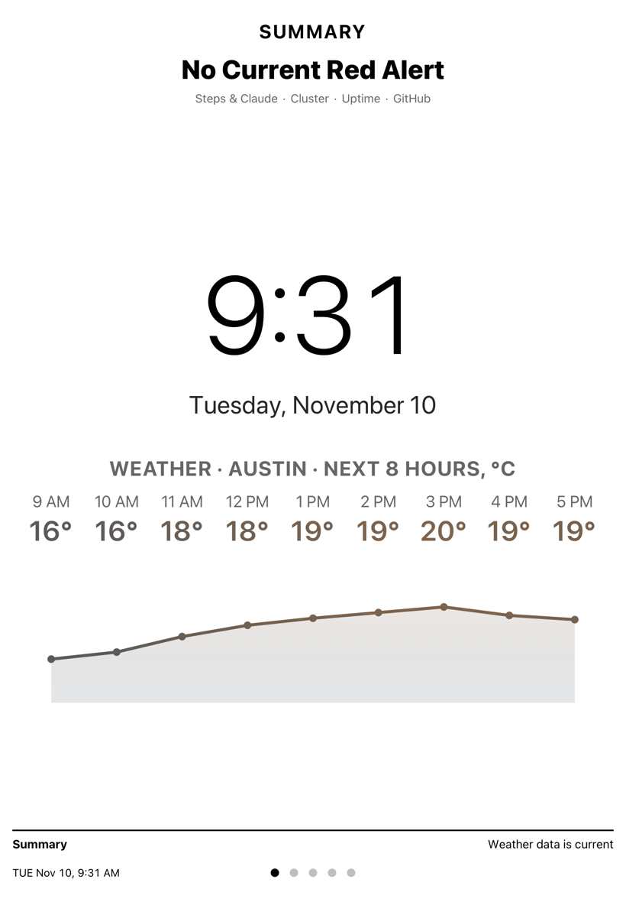
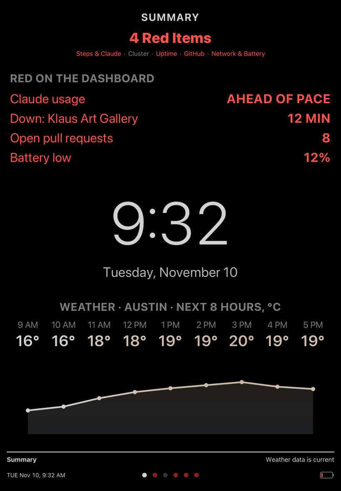
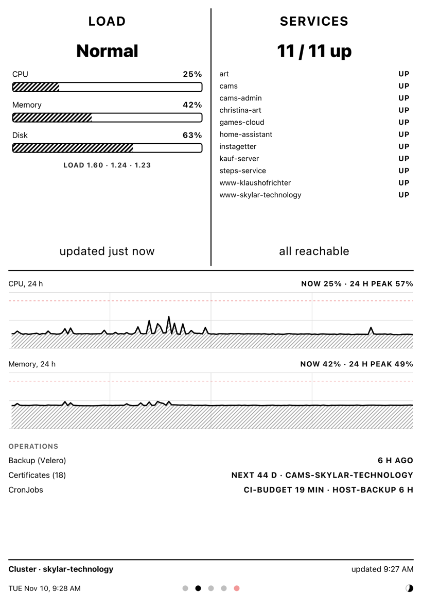
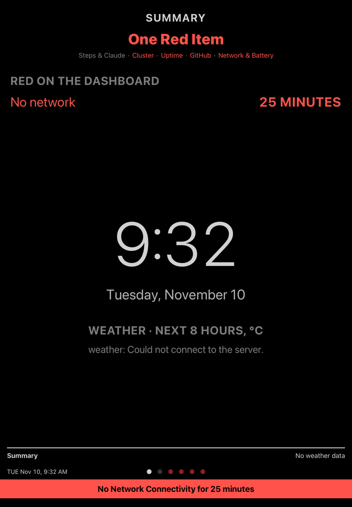
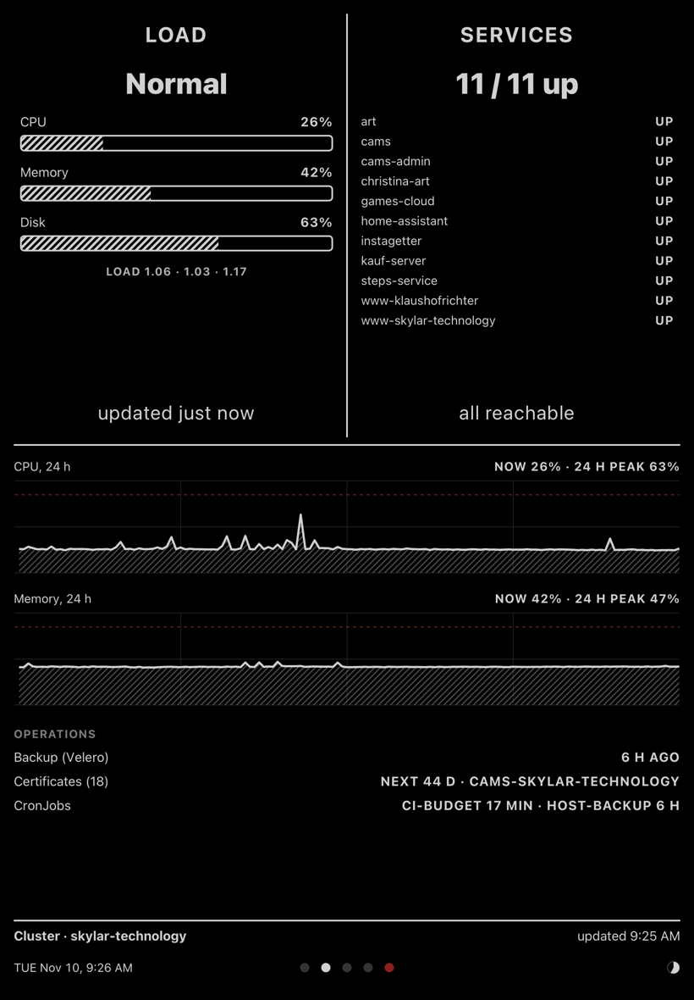
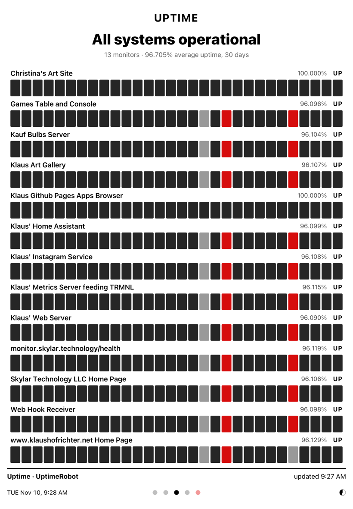
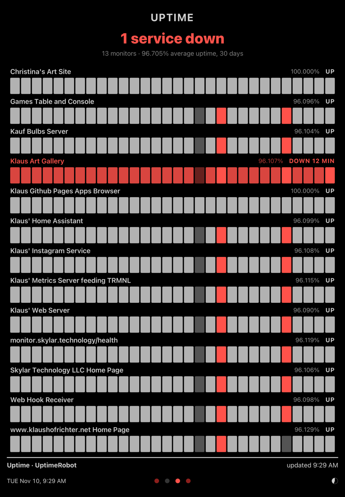
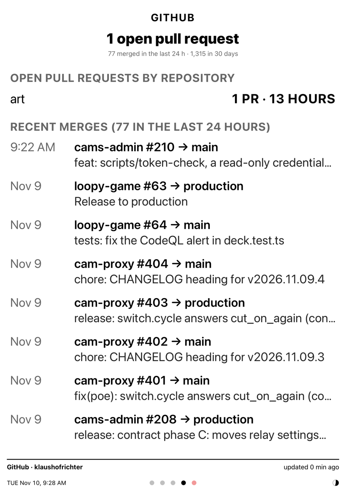
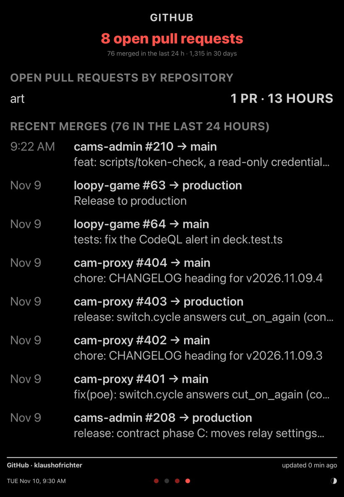
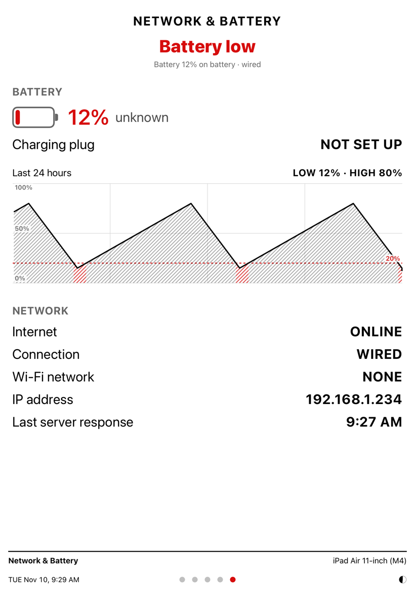

# iPadDash

**A calm wall dashboard for an iPad that Apple stopped updating years ago.**

iPadDash turns an old iPad (an iPad Air from 2013 on iOS 12 works fine) into an
always-on status display: one glance tells you whether anything needs attention,
and if nothing does, it shows the time and the weather and stays out of the way.

<p>
  
  
  
</p>

## What it does

- **Gives an old iPad a job.** Native UIKit, built for iOS 12. No web view, no
  server of its own, no account. An iPad that can no longer run current apps
  runs this all day.
- **One summary page.** Everything that is red anywhere on the dashboard, in one
  list, over a large clock and the next hours of weather. It can stay on screen
  permanently; the other pages only matter when it says so.
- **Pages for the things we watch.** A Kubernetes cluster, website uptime, GitHub
  pull requests, daily steps and Claude usage, and the iPad's own battery and
  network.
- **Calm by design.** Black on white or grey on black, one accent color (red) that
  means "look at this", slow cross-fades between pages, and a screen that dims
  with the room.
- **Easy to extend by asking.** A new page is one small Swift file on a shared
  template. Describe what you want to an LLM such as Claude and it builds the page.
- **Looks after the hardware.** Keeps the battery between 40 % and 70 % through a
  smart plug, goes dark at night, and is deployed over Wi-Fi so the iPad never
  needs a cable to the Mac.

## A second life for an outdated iPad

Old iPads are everywhere: good screens, silent, low power, and stuck on an iOS
version that the App Store has left behind. The devices this runs on are two
first-generation iPad Airs on iOS 12.5.8. Safari on them struggles with modern
web dashboards, and most apps no longer install.

iPadDash is written for exactly that device:

- **iOS 12 APIs only.** UIKit and Core Graphics; no SwiftUI, Combine, async/await
  or SF Symbols. Icons such as the battery are drawn in code. The deploy script
  checks the binary and refuses to install anything iOS 12 cannot load.
- **Light on the device.** Pages fetch small JSON answers and draw them directly.
  There is no browser engine running.
- **No cable needed.** After a one-time setup, builds are installed and launched
  over Wi-Fi with `./deploy.sh`.
- **Kind to an old battery.** A device that is always plugged in ages its battery
  by sitting at 100 %. iPadDash switches its own charger (see
  [Battery care](#battery-care)).

## The summary page

The summary page is the home page, and the main idea of the dashboard: **you
should not have to look at five pages to learn that everything is fine.**

<p>
  
  
  
</p>

- **Nothing red:** "No Current Red Alert", a large clock, the date, and the
  temperature for the next eight hours where the iPad is.
- **Something red:** every red item from every page is listed (up to five, then
  "+ 3 more"). The clock and weather make room: the graph goes first, then the
  hourly numbers, and the clock always stays.
- **Tap a red row** or a page name to open that page. It fades back to the summary
  on its own.
- **No network:** one row and a banner say so, instead of every page reporting its
  own failed fetch.

With the summary page switched on in Settings, the dashboard **stays on it** and
does not rotate. The other pages are one swipe away, and they come to you (as red
rows) when they have something to say. With it switched off, the dashboard
rotates through the pages on a timer.

## The pages

### Cluster

Load and health of a k3s cluster, read from Grafana Cloud (Prometheus): CPU,
memory and disk, which services answer, 24-hour graphs, and the age of the last
backup, certificate expiry and CronJobs.

<p>
  
  
</p>

This is the **split page** layout: two panels on top, the detail below.

### Uptime

UptimeRobot monitors with 30 days of history, one bar per day. A monitor that is
down turns its row red, with how long it has been down.

<p>
  
  
</p>

### GitHub

Open pull requests by repository with the age of the oldest, and the most recent
merges with their target branch. More than five open pull requests turns the
headline red.

<p>
  
  
</p>

### Network & Battery

The iPad watching itself: battery level and its last 24 hours, the charging plug,
and how it is connected. This page only joins the rotation while something on it
is red, such as a low battery, an unreachable plug or a network outage.

<p>
  
</p>

### Steps & Claude

Daily steps against pace, and Claude usage against the weekly and session
windows. This page started the project, as a port of a TRMNL e-ink design.

### Night screen

From 10 PM to 5 AM the dashboard shows only a dim clock at the lowest screen
brightness. A tap brings the dashboard back for 15 minutes. The pages keep
updating underneath and battery care keeps working.

<p>
  
</p>

## Calm visuals

A wall display is in the room all day. It should be readable from across the room
and otherwise not ask for attention.

- **Two inks.** Everything is black on white, or soft grey on black in the dark
  theme. There are no brand colors, icons or decorations.
- **Red means something.** Red is used only for things that need a look: stale
  data, a service down, a low battery. If nothing is red, nothing is wrong. The
  page dots at the bottom turn red too, so a problem on another page is visible
  from any page.
- **Muted where color helps.** The weather graph is tinted by temperature, in
  colors quiet enough to sit next to the rest.
- **Slow transitions.** Pages cross-fade over about a second and a half instead of
  sliding or jumping. A small countdown circle in the corner shows that the
  display is alive and when the next page comes.
- **Follows the room.** The front camera samples the room's brightness from time
  to time (no images are read or kept) and dims the screen and the palette in a
  dark room.
- **The same frame on every page.** A title at the top, the content, a thin rule,
  then the page's name and status, and below that the time, page dots and
  countdown. Your eye always knows where to look.

## Add your own page by asking

The pages here are what one household watches. Yours will differ, and the code is
arranged so that a new page is quick to add, by you or by an LLM such as Claude.

A page is a small subclass of `DashboardPageViewController`:

1. Pick a template in `viewDidLoad`: `addFullPage(title:)` or
   `addSplitPage(left:right:bar:)`. The template draws the title, the rule and the
   title bar, and hands back the area to fill.
2. Fetch in `load(completion:)`. `fetchJSON` does the request and reports to the
   shared connectivity check.
3. Draw in `render()`, and set `alerts` to whatever should be red. The page dot,
   the summary page and the rotation pick that up without further code.

Refresh timers, tap and swipe-up reloads, "refreshing…" and "updated 9:41 AM" in
the title bar, light and dark themes: all of that comes from the base class.

In practice you describe the page. With [Claude Code](https://claude.com/claude-code)
in this repository, a request like this is enough:

> Add a page that shows today's and tomorrow's entries from my calendar feed at
> https://example.com/calendar.ics. Use the full-page template like the Uptime
> page. Turn an entry red when it starts within 15 minutes. Add a test and deploy
> it to the black iPad.

Every page in this repository was built that way, in conversation: "show the
cluster's backup age", "turn the row red when a certificate expires within two
weeks", "drop the graph when there is no room". The existing pages are the
examples the model works from, the unit tests (`./test.sh`) check that every page
keeps the shared frame, and `./deploy.sh` puts the result on the wall a minute
later.

## What we use it for

- **A hallway status light for a home cluster.** Two iPads on the wall show
  whether the k3s cluster, its services, backups and certificates are healthy.
  Most days the answer is the clock.
- **Knowing a website is down before a visitor says so.** The uptime page turns a
  row red; the summary page says which site and for how long.
- **Keeping pull requests from piling up.** Open pull requests by repository, with
  their age, and a red headline when there are too many.
- **A daily nudge.** Steps against the day's pace, and how much of the Claude
  usage window is left.
- **A clock and weather station** that happens to tell you when something broke.
- **Two modes, two iPads.** One stays on the summary page; the other rotates
  through all pages.

## Battery care

An iPad on a charger around the clock sits at 100 %, which ages the battery and
can make it swell. iPadDash manages its own charger:

- Plug the charger into a TP-Link Kasa smart plug (HS105 or HS100) and enter the
  plug's **name** from the Kasa app in Settings, for example `Garland`.
- The app switches the plug on at 40 % and off at 70 %, talking to the plug
  directly on the local network. No Kasa account or cloud is involved.
- It finds the plug by name, so it keeps working when the router gives the plug a
  new address.
- While the plug is off, a timer on the plug itself turns it back on within two
  hours unless the app keeps renewing it. A crashed app or lost Wi-Fi cannot let
  the iPad run flat.

## Using it

| Gesture | What it does |
| --- | --- |
| Swipe left / right | Switch page |
| Swipe up | Reload the page (on the summary page: all pages). A small pill confirms it. |
| Tap | Freeze the page for 15 minutes and reload it |
| Long press | Switch between light and dark |
| Swipe down | Settings |

Settings covers the update interval, auto-move, the summary page, the charging
plug, the theme, the clock format and ambient light.

## Setting it up

You need a Mac with Xcode, an Apple ID added in Xcode, and
`brew install ideviceinstaller`.

1. Put the credentials for the pages you use into `.env` (git-ignored):

   ```
   STEPS_ACCESS_TOKEN=...
   GRAFANA_PROM_USER=...
   GRAFANA_PROM_TOKEN=...
   UPTIMEROBOT_API_KEY=...
   GITHUB_PAT=...
   ```

   All of them are read-only keys. A page without its key says so and the rest
   still work.

2. Connect the iPad by USB once and enable "Show this iPad when on Wi-Fi" in
   Finder. After that the cable is not needed.

3. Build, install and launch:

   ```bash
   ./deploy.sh
   ```

   With several iPads, name one by its color or use `all`: `./deploy.sh black`.
   Settings can be passed along: `./deploy.sh black chargePlug=Garland`.

Other commands:

```bash
./deploy.sh --check
```

builds without signing and checks that the binary loads on iOS 12.

```bash
./test.sh
```

runs the unit tests in an iPad simulator.

The data sources are specific to this household (a steps service, one Grafana
Cloud stack, one UptimeRobot account, one GitHub user). Pointing a page at your
own source, or replacing it, is the kind of change described under
[Add your own page by asking](#add-your-own-page-by-asking).
